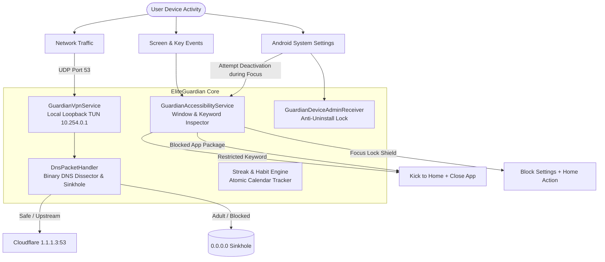
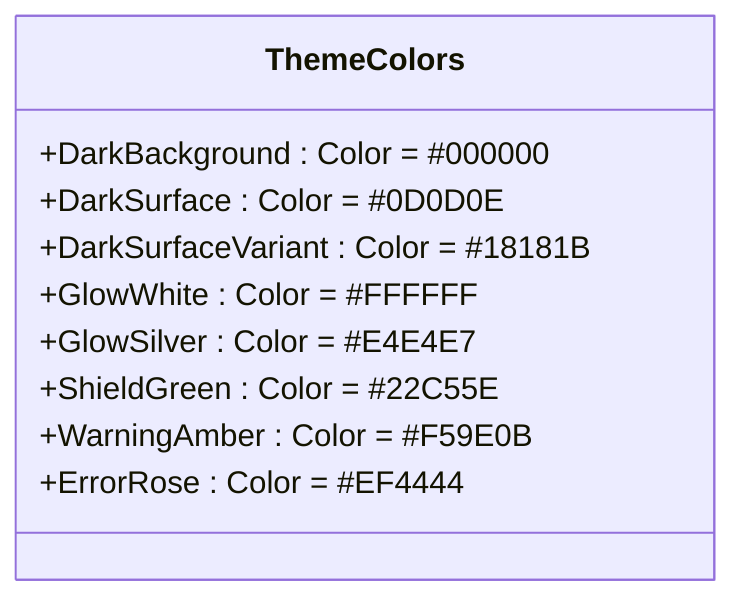
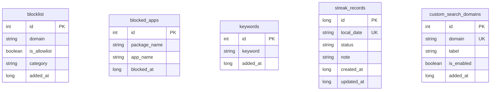

# EliteGuardian: Complete Developer & Architecture Guide

A comprehensive, production-grade architectural guide and build manual for the **EliteGuardian** Android application. This document details every subsystem, architectural layer, security model, and build procedure for engineers working on or extending the codebase.

---

## 1. System Overview & Core Philosophy

EliteGuardian is an on-device accountability and digital wellness platform engineered for Android. Unlike commercial blockers that rely on remote proxies or sell user data, EliteGuardian is built on three core pillars:

1. **100% On-Device Processing**: All domain parsing, DNS packet inspection, keyword heuristics, and app interception happen locally inside a loopback VPN and Accessibility service. Zero browsing history leaves the device.
2. **Deterministic Friction**: The app uses Android Device Administrator policies, strict Focus Mode locking, and delayed unblock cooldown timers to eliminate impulsive lapses.
3. **True OLED Minimalist Aesthetic**: A specialized high-contrast palette consisting of pure pitch black (`#000000`), glowing white (`#FFFFFF`), and luminous silver accents.



---

## 2. Technology Stack & Environment Requirements

| Layer | Technology | Specification / Version |
| :--- | :--- | :--- |
| **Language** | Kotlin | `1.9.24` / JVM Target `17` |
| **UI Framework** | Jetpack Compose | Material 3 (BOM `2024.06.00`) |
| **Android SDK** | Android OS | Compile SDK `35`, Target SDK `35`, Min SDK `26` (Android 8.0 Oreo) |
| **Build System** | Gradle & AGP | Gradle `8.5.2`, Kotlin Symbol Processing (KSP) |
| **Local Persistence** | AndroidX Room | Room `2.6.1` SQLite with Coroutines Flow |
| **Settings Storage** | Jetpack DataStore | Preferences DataStore `1.1.1` + Sync SharedPreferences cache |
| **Async Architecture**| Kotlin Coroutines | `StateFlow`, `SharedFlow`, `Dispatchers.IO`, Structured Concurrency |
| **Background Jobs** | AlarmManager & WorkManager | `WorkManager 2.9.1` + Exact Alarm Receivers |
| **Testing** | JUnit 4 & Coroutines Test | `JUnit 4.13.2`, `kotlinx-coroutines-test 1.8.1` |

---

## 3. Architecture Blueprint (MVVM + Clean Architecture)

The codebase follows the recommended Android architecture guidelines separated into distinct, testable layers:

```mermaid
graph TD
    subgraph Presentation Layer
        ComposeUI[Jetpack Compose Screens & Dialogs]
        VM[AndroidViewModel / ViewModels]
    end

    subgraph Domain Layer
        Calculators[StreakCalculator / Milestone Engine]
        Matchers[DomainMatcher / SafeSearchRules]
        Validators[DomainValidator / Input Cleaners]
    end

    subgraph Data Layer
        Repos[Repositories: Filter, Search, Streak, AppBlocker, Keyword]
        DataStore[Jetpack DataStore Preferences]
        FastSync[Sync SharedPreferences Cache]
        RoomDB[AppDatabase Room SQLite DB]
    end

    subgraph System Services Layer
        VPNService[GuardianVpnService]
        A11yService[GuardianAccessibilityService]
        AdminReceiver[GuardianDeviceAdminReceiver]
        StreakReceiver[StreakReminderReceiver]
    end

    ComposeUI <-->|StateFlow & Events| VM
    VM --> Repos
    Repos --> Domain Layer
    Repos <--> RoomDB
    Repos <--> DataStore
    Repos <--> FastSync

    SystemServicesLayer --> Repos
    SystemServicesLayer --> FastSync
```

### Directory Structure Mapping

- [`app/src/main/java/com/eliteguardian/app/`](file:///home/nisath/Lab/EliteGuardian/app/src/main/java/com/eliteguardian/app)
  - `accessibility/`: Accessibility service implementation, text/window inspection, anti-tamper logic.
  - `data/database/`: Room Entities (`BlocklistEntity`, `StreakRecordEntity`, `BlockedAppEntity`, `KeywordEntity`, `CustomSearchDomainEntity`) and DAOs.
  - `data/preferences/`: `AppPreferences.kt` with DataStore Flow mappings and synchronous thread-safe getters.
  - `data/repository/`: Repositories mediating Room and DataStore operations.
  - `domain/`: Pure Kotlin business logic (`StreakCalculator`, `SafeSearchRules`, `DomainMatcher`).
  - `navigation/`: Compose navigation route definitions (`Screen.kt`).
  - `notifications/`: Alarm scheduling utilities for habit reminders.
  - `receiver/`: System BroadcastReceivers for Boot, Device Admin, and Streak alerts.
  - `security/`: PBKDF2 PIN hashing and salt generation.
  - `ui/`: Compose screens, ViewModels, dialogs, and custom widgets organized by feature (`dashboard`, `blocklist`, `apps`, `keywords`, `focus`, `search`, `streak`, `settings`).
  - `ui/theme/`: True OLED color definitions, Material 3 typography, and dark theme setups.
  - `vpn/`: Android `VpnService` engine, low-level DNS dissector, and sinkholing packet handlers.

---

## 4. Subsystems Deep Dive

### 4.1. Local Loopback VPN & DNS Packet Dissector

EliteGuardian creates a local VPN interface using Android's `VpnService.Builder`:
- **Interface Configuration**:
  - Virtual IP: `10.254.0.1/30`
  - Virtual DNS Server Route: `10.254.0.2:53`
  - MTU: `1500` bytes
  - Routes only DNS traffic (`10.254.0.2/32`) or overall queries directly through the virtual TUN descriptor.
- **Binary DNS Inspection (`DnsPacketHandler.kt`)**:
  - Intercepts raw IPv4 UDP packets on port 53.
  - Extracts the UDP payload and decodes the DNS header (Transaction ID, Flags, Questions Count).
  - Parses QNAME labels (e.g. `\x06google\x03com\x00` -> `google.com`).
- **Sinkholing & SafeSearch VIP Rewriting**:
  1. **Custom Domain / Blocklist Match**: If the domain matches a blocked entry or category, the engine synthesizes an immediate DNS response mapping the A record to `0.0.0.0` (sinkhole) with TTL = 300s.
  2. **SafeSearch VIP Enforcement**: If the queried domain is a supported search engine (Google, Bing, DuckDuckGo, YouTube), the resolver rewrites the DNS answer with official SafeSearch VIP addresses (e.g. `216.239.38.120` for `forcesafesearch.google.com`).
  3. **Upstream Forwarding**: Allowed queries are securely forwarded to **Cloudflare Family DNS** (`1.1.1.3:53`), which applies an additional layer of baseline malware and adult content filtering. The response is rewritten back to the virtual TUN descriptor.

### 4.2. Accessibility Shield & Real-Time Tamper Protection

The `GuardianAccessibilityService` runs continuously with `AccessibilityEvent.TYPES_ALL_MASK` and `FLAG_RETRIEVE_INTERACTIVE_WINDOWS`:
- **App Blocker**: Whenever an active window belongs to a blocked package in `BlockedAppDao`, the service calls `performGlobalAction(GLOBAL_ACTION_HOME)` and `performGlobalAction(GLOBAL_ACTION_BACK)`.
- **Keyword Filter**: Detects typed characters and window node text. If a restricted keyword from `KeywordDao` is detected, it shuts down the offending foreground app instantly.
- **Focus Mode Device Administrator Anti-Tamper**:
  - When Focus Mode is running (`appPreferences.isFocusModeActiveSync() == true`), the user cannot deactivate Device Admin or uninstall EliteGuardian.
  - If the user opens `com.android.settings` or any `packageinstaller` window containing `"EliteGuardian"` and actions like `"Deactivate"`, `"Uninstall"`, `"Force Stop"`, `"Clear data"`, or `"Disable"`, the service intercepts the window, closes it immediately back to the Home launcher, and displays a warning toast.

### 4.3. Device Administrator (`GuardianDeviceAdminReceiver`)

- Registered in `AndroidManifest.xml` with `android.permission.BIND_DEVICE_ADMIN` and metadata pointing to `res/xml/device_admin_policies.xml`.
- When active, standard Android OS blocks uninstallation from launcher drag-and-drop or Play Store unless the user first visits Settings > Security > Device Admin apps to deactivate.
- **Focus Session Precedence**: During an active Focus session, the in-app deactivation button is disabled. If system deactivation is attempted, `GuardianDeviceAdminReceiver.onDisableRequested` returns an alert message, and the Accessibility Service closes the deactivation dialog.

### 4.4. Streak & Habit Recovery Tracker

- **Calculation Model (`StreakCalculator.kt`)**:
  - Pure functional calculation evaluating an ordered list of `StreakRecordEntity` against `LocalDate.now()`.
  - Calculates current streak, longest streak, total clean days, total lapses, and completion rates.
  - Evaluates milestone badges: 3 Days, 7 Days, 14 Days, 1 Month, 2 Months, 90 Days, 180 Days, and 1 Year.
- **Persistence & Constraint Safety (`StreakRepository.kt`)**:
  - To prevent SQLite unique index collisions on `local_date`, updates and lapses execute atomic replacements (`deleteByDate` followed by clean `insertOrUpdate`).
- **Neutral Daily Reminders**:
  - Non-shaming daily check-in notifications scheduled via `AlarmManager.setExactAndAllowWhileIdle()` and received by `StreakReminderReceiver`.

### 4.5. Search Restriction Engine (`SearchRestrictionRepository.kt`)

- Manages 10 built-in search engines: Google, Bing, Yahoo, DuckDuckGo, Ecosia, Brave, Yandex, Baidu, Startpage, and Qwant.
- Allows selective engine blocking, blanket SafeSearch enforcement, or locking down all alternative search engines whenever Focus Mode starts.

---

## 5. UI Architecture & Design System

The application strictly enforces an OLED Black & Glowing White aesthetic:



### Contrast Rules for Components
1. **Action & Confirm Buttons**:
   - `containerColor = Color.White`
   - `contentColor = Color.Black`
   - Inner text styled with `Text("Action", color = Color.Black, fontWeight = FontWeight.Bold)`
2. **Floating Action Buttons**:
   - `containerColor = Color.White`
   - `contentColor = Color.Black`
   - `Icon(imageVector = Icons.Default.Add, tint = Color.Black, modifier = Modifier.size(28.dp))`
3. **Switches**:
   - Active: `checkedThumbColor = Color(0xFF000000)`, `checkedTrackColor = Color(0xFFFFFFFF)`
   - Inactive: `uncheckedThumbColor = Color(0xFFA1A1AA)`, `uncheckedTrackColor = Color(0xFF18181B)`

---

## 6. Database Schema Reference

All data is stored in the Room database `elite_guardian_database` (Schema version: 3):



---

## 7. Developer Build & Test Workflow

### Prerequisites
- JDK 17 installed and configured (`JAVA_HOME`).
- Android SDK 35 installed with platform tools (`adb`).

### Common Gradle Commands

```bash
# 1. Clean build cache
./gradlew clean

# 2. Run all unit tests
./gradlew testDebugUnitTest

# 3. Assemble debug APK
./gradlew assembleDebug

# 4. Run tests and assemble APK in one pass
./gradlew testDebugUnitTest assembleDebug

# 5. Install to connected device or running emulator
adb install -r app/build/outputs/apk/debug/app-debug.apk
```

### Essential Logcat Debugging Filters

```bash
# Monitor VPN and DNS sinkholing in real-time
adb logcat -s "GuardianVpn" "DnsPacketHandler"

# Monitor Accessibility blocking and keyword detection
adb logcat -s "GuardianA11y" "EliteGuardian"

# Monitor Device Admin and Focus Mode locks
adb logcat -s "GuardianDeviceAdmin" "FocusMode"
```

---

## 8. Troubleshooting & Common Developer Pitfalls

1. **VPN Loopback Socket Leak**:
   - Always invoke `protect(socket)` inside `DnsPacketHandler` before sending UDP packets upstream to prevent recursive loops where the VPN tries to route its own socket through the virtual TUN interface.
2. **Android 13+ Restricted Settings for Accessibility**:
   - Android 13+ disables accessibility for side-loaded APKs by default. When testing on Android 13+, open **Settings > Apps > EliteGuardian > 3 Dots Menu > Allow restricted settings** before enabling Accessibility.
3. **Deactivating Device Administrator in Development**:
   - If an active Focus Mode test session is locking the device admin, let the timer expire or run:
     ```bash
     adb shell dpm remove-active-admin com.eliteguardian.app/.receiver.GuardianDeviceAdminReceiver
     ```
   - Alternatively, clearing app data via ADB overrides test locks:
     ```bash
     adb shell pm clear com.eliteguardian.app
     ```

